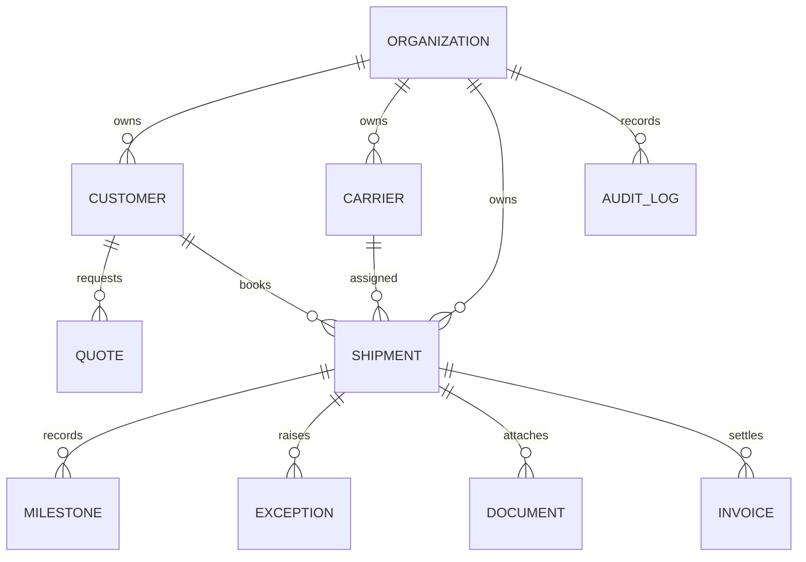

# Data architecture and dictionary

## Principles

- One shipment/job identifier is the operational spine.
- Financial snapshots are captured on quotes and shipments; changing a future buy rate must not silently rewrite historical margin.
- Milestones are append-only events; corrections are new events referencing the superseded event.
- External identifiers are stored alongside internal identifiers.
- Every tenant-owned row includes `organization_id`.
- Store timestamps in UTC; render in the user's timezone.
- Store currency explicitly; never sum unlike currencies without conversion and FX timestamp.
- Store raw partner payloads privately with a hash and schema version for audit/replay.

## Entity relationship overview



## Included executable tables

| Table | Core fields | Purpose |
|---|---|---|
| organizations | id, name, plan | Tenant boundary |
| customers | name, country, segment, payment_terms, credit_limit | Shipper/consignee/customer account |
| carriers | name, modes, on_time_target, active | Transport service provider |
| shipments | reference, lane, mode, status, etd, eta, cargo, costs | Shipment/job record |
| quotes | quote_number, customer, lane, cost stack, margin, sell, status | Commercial offer |
| milestones | event_code, event_name, location, occurred_at, source | Append-only operational event history |
| exceptions | category, severity, description, action, owner, status | Disruption and resolution work queue |
| documents | filename, category, extracted text/fields, shipment_id | Document metadata and parser result |
| invoices | invoice type, amount, currency, issue/due/paid dates | Receivable/payable ledger |
| audit_logs | actor, action, entity, details, created_at | Demo audit history |

## Production tables to add

- `users`, `organization_memberships`, `roles`, `permissions`, `api_clients`, `api_scopes`.
- `locations` with UN/LOCODE, IATA code, country, timezone and geospatial fields.
- `shipment_legs`, `transport_calls`, `equipment`, `container_events`, `documents_objects`.
- `partner_integrations`, `partner_credentials_ref`, `webhook_subscriptions`, `idempotency_keys`.
- `raw_partner_events`, `event_outbox`, `event_dead_letters`, `event_replay_jobs`.
- `rate_cards`, `rate_components`, `customer_contracts`, `approval_rules`, `quote_versions`.
- `invoice_lines`, `settlements`, `fx_rates`, `tax_jurisdictions`, `credit_notes`.
- `sla_policies`, `exception_actions`, `notification_deliveries`, `usage_events`.
- `model_runs`, `ai_decisions`, `human_approvals`, `prompt_versions`, `evaluation_cases`.

## Canonical event envelope (internal target)

```json
{
  "event_id": "evt_01J...",
  "organization_id": "org_...",
  "shipment_id": "shp_...",
  "provider": "carrier-adapter-name",
  "provider_event_id": "external-event-id",
  "event_code": "VESSEL_DEPARTED",
  "event_type": "TRANSPORT",
  "event_time": "2026-11-09T06:20:00Z",
  "received_time": "2026-11-09T06:24:12Z",
  "location": {"name": "Shanghai", "unlocode": "CNSHA"},
  "references": [{"type": "CONTAINER", "value": "ABCD1234567"}],
  "source": "API",
  "schema_version": "1.0",
  "raw_payload_sha256": "..."
}
```

This is a proposed NEXUS canonical envelope inspired by DCSA/IATA concepts, not a verbatim DCSA or ONE Record payload.

## Data quality and validation

- Lane locations require a validated UN/LOCODE or IATA code in production.
- ETD must precede ETA; actual timestamps cannot precede impossible predecessor events without an override.
- Gross weight, volume and package count are non-negative and use defined units.
- Currency is ISO 4217; country and location codes are from controlled reference data.
- Duplicate external event IDs are idempotently ignored or quarantined.
- Conflicting carrier events are not overwritten silently; retain source and confidence.
- Rate components preserve source, effective period, currency and contractual context.
- Gross margin uses sell-price denominator; markup uses buy-cost denominator.

## Retention and data governance

Documents can contain personal, commercial and regulated trade information. Production must set data residency and retention based on customer contract and applicable law. Encrypt data in transit and at rest, use least-privilege service identities, support export/deletion, and keep immutable security/audit evidence where legally required.
