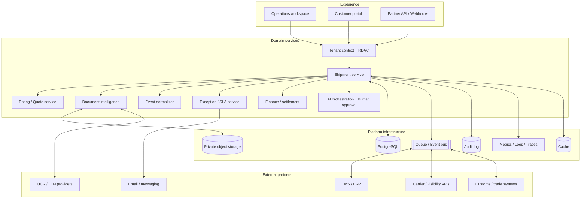

# System architecture

## 1. Design stance

The classroom build is a modular monolith in Streamlit + Python with SQLAlchemy. This is intentionally simpler to deploy than a distributed system while keeping domain services separable. The production target is an API-backed application with asynchronous workers.

## 2. Logical architecture

## 3. Production deployment target

- **Experience:** web app for operations, pricing, finance and customer self-service.
- **API gateway:** versioned REST API, tenant authentication, scopes, rate limits and idempotency.
- **Domain services:** shipment, quote/rating, document, event ingestion, exception, invoice and customer.
- **Async workers:** OCR/LLM extraction, carrier polling/webhooks, ETA features, notifications, reconciliations and exports. The prototype includes an opt-in OpenAI Responses API document-field adapter; no AI key is bundled.
- **Queue:** managed message queue or event bus with retries, dead-letter queues and replay.
- **Operational database:** managed PostgreSQL with tenant-aware indexes and transaction boundaries.
- **Object store:** private S3-compatible storage; encrypted objects, malware scan, short-lived signed access and retention rules.
- **Analytics:** warehouse/lakehouse for history and cross-customer aggregated metrics; never expose one tenant's records to another.
- **Observability:** central structured logs, traces, SLOs, error rates, job latency and audit events.

## 4. Event-driven shipment lifecycle

1. Request received (email/API/portal/upload).
2. Request normalised; party, lane, mode, cargo and document references extracted.
3. Rate options collected from approved carrier/customer rate sources.
4. Quote calculated and checked against margin floor / approval matrix.
5. Quote issued; customer accepts or rejects.
6. Accepted quote creates a booking/job with commercial snapshot.
7. Booking, shipping instruction and documents are validated.
8. Partner milestones arrive via webhook, API poll, EDI or manual update.
9. Raw event is stored; adapter maps it to the canonical event schema.
10. Idempotency check prevents duplicate event processing.
11. Shipment projection and ETA/risk signals are updated.
12. Exception rules create/refresh an owned exception; notifications are sent.
13. Delivery, equipment return and financial settlement complete the job.
14. Analytics uses event history plus commercial snapshots.

## 5. Integration and standards strategy

### DCSA Track & Trace

Use DCSA event types and definitions as a mapping target for containerised ocean milestones (shipment, transport, equipment, IoT and reefer observations). The NEXUS internal event schema should preserve provider IDs, event time, received time, location, references and raw-payload hash. Do not claim conformance until API implementation and DCSA conformance testing are completed.

### IATA ONE Record

Use IATA ONE Record's digital air-cargo object model and secured API as the target mapping for air cargo. The current prototype does not publish or consume the ONE Record API. Adapter implementation and security onboarding are future work.

### Existing systems

Prioritise connectors to existing forwarder TMS/ERP systems. Start with CSV/SFTP and REST where partner APIs are available; add EDI mappings where required. Do not assume every carrier offers the same data or commercial access.

## 6. Domain boundaries

- **Commercial:** quotes, rate components, margin, customer contract, approval.
- **Execution:** booking, route, equipment, shipment state and milestones.
- **Documents:** metadata, classification, extracted fields, secure binary object reference.
- **Visibility:** event ingestion, event normalisation, ETA and risk signals.
- **Exception:** severity, reason, owner, SLA clock, actions and resolution evidence.
- **Finance:** customer receivable, carrier payable, accrual and reconciliation.
- **Platform:** tenant, users, roles, integrations, usage, audit, billing and policy.

## 7. State machine and transaction safety

The prototype restricts status transitions:

- Draft → Quoted / Cancelled
- Quoted → Booked / Cancelled
- Booked → In transit / Exception / Cancelled
- In transit → Customs hold / Exception / Delivered
- Customs hold → In transit / Exception / Delivered
- Exception → In transit / Customs hold / Delivered
- Delivered and Cancelled are terminal in the demo.

Production should make state changes transactional with the milestone insert, audit write and outbox event. Use an outbox pattern so a database commit cannot succeed while event publication silently fails.

## 8. Security and trust boundaries

- OIDC/SAML SSO; MFA for privileged roles.
- Tenant isolation at API and database layers; row-level controls as defence in depth.
- Least-privilege RBAC; separation of pricing, operations and finance permissions.
- No raw credentials in source code; use cloud secrets manager.
- Document malware scanning, file size/type controls and encrypted object storage.
- Signed, short-lived document URLs; never public buckets for shipping docs.
- Audit log for approvals, pricing changes, status transitions and finance actions.
- Human approval for carrier booking, rate commitments, customs release and payment execution.
- Data retention, deletion, legal hold and subject-access processes.
- Threat modelling, penetration tests, dependency scanning and incident-response drills.

## 9. Scale path

**Prototype:** Streamlit + SQLite / PostgreSQL; synthetic data; synchronous local document parsing.

**Pilot:** external PostgreSQL, object store, OIDC, limited carrier/TMS connector, background job queue, structured logging and tenant isolation.

**Commercial SaaS:** separate API and worker services; event bus; analytics warehouse; high-availability database; multi-region object storage; SLOs; SOC 2 / ISO 27001 programme; disaster recovery; security reviews and documented support operations.

**Network platform:** partner onboarding, standardised event exchange, customer/partner portals, network data products and carefully governed benchmarking.
